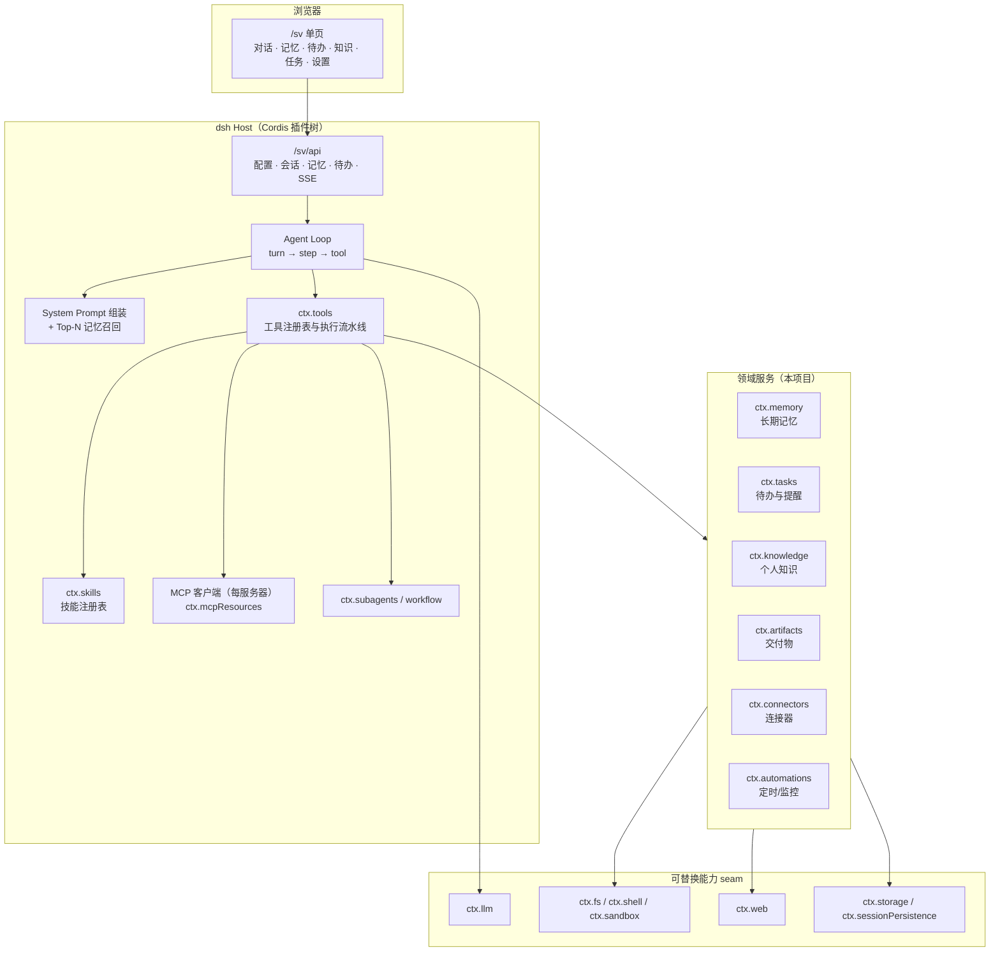

# Singularity Voyage

以 [DeepSeek Harness](https://deepseek-harness.github.io/deepseek-harness/)（`dsh`）为编排内核的**个人 Agent**：记住你的偏好与进行中的事，按时提醒，把笔记、写作与信息巡检收在同一个入口。

> **当前状态：M0 对话底座 + M1 个人助理（记忆 / 待办提醒）已跑通。** 自定义模型路由、Web 搜索、聊天页面与 SSE 流式对话、长期记忆与待办提醒均已实现并验证；下一步是 M2 个人知识。路线图见[架构设计 · 里程碑](docs/architecture.md#12-里程碑)。

[整体架构](docs/architecture.md) · [上游文档](https://deepseek-harness.github.io/deepseek-harness/) · [MCP 规范](https://modelcontextprotocol.io/)

---

## 1. 项目定位

Singularity Voyage 是一个**个人 Agent**，构建在 DeepSeek Harness 之上：

- **DSH 负责编排**：Agent Loop、模型适配、工具执行流水线、会话日志、权限与沙箱、Skill 与 MCP、子 Agent、Web 传输。
- **本项目负责「记得住、会主动、够顺手」**：长期记忆、待办与提醒、个人知识、写作、定时巡检，以及 `/sv` 单页体验。

它不是团队协作平台，也不追求「什么领域都做」。目标是在一个人真实的一天里，把个人助理、第二大脑、自动化管家三种角色，以及它们共享的长期记忆，连成一条连续的上下文。

### 四条能力闭环

| 场景 | 要解决的问题 | 关键能力 |
|---|---|---|
| 个人助理 | 事情记不住、提醒不及时 | 长期记忆、待办/提醒、每日简报 |
| 第二大脑 | 资料散落、找不到、写不出来 | 个人知识导入与检索、引用、写作草稿 |
| 自动化管家 | 重复巡检、信息过载 | 定时任务、网页/关键词监控、收件箱 |
| 长期陪伴 | 每次都要重新解释自己 | 跨场景共享同一套记忆与任务模型 |

### 核心设计原则

| 原则 | 含义 |
|---|---|
| 编排下沉，能力上浮 | 不重写 Agent Loop；只通过 DSH 的公开扩展点增加能力 |
| 记忆可纠正 | 记忆带来源与置信度，用户可查看、修改、删除；删掉就不再注入 |
| 主动但克制 | 主动提醒有频率上限与静默时段，巡检默认只读 |
| 一切皆插件 | 会话、工具、模型、Skill、MCP、页面都是可装卸的 Cordis 插件 |
| 能力即 seam，本地优先 | 文件系统、Shell、Web、存储、模型、检索都通过接口替换提供方；默认只跑本机 |
| 日志即事实 | 会话 JSONL 保存原文与来源；记忆保存「当前有效结论」，二者靠来源关联 |
| 单用户，默认安全 | 单机单用户；`workspace-write` + 审批；个人数据默认不出本机 |

---

## 2. 架构总览



### 六层职责

| 层 | 内容 | 归属 |
|---|---|---|
| L0 运行时 | `dsh` CLI、profile、bundle、patch 叠层 | 上游 + 本项目 profile |
| L1 编排内核 | Agent Loop、Session 日志、System Prompt、工具流水线、子 Agent | 上游 |
| L2 能力 seam | `ctx.llm`、`ctx.fs`、`ctx.shell`、`ctx.sandbox`、`ctx.web`、`ctx.storage` | 上游接口，本项目按需替换提供方 |
| L3 领域服务 | 记忆、待办与提醒、知识、交付物、连接器、自动化 | 本项目 |
| L4 工具与技能 | 面向模型的工具、Skill 目录、模式（Mode） | 本项目 |
| L5 产品体验 | `/sv` 单页、CLI/Headless | 本项目 |
| L6 数据与可观测 | 会话存储、投影、索引、本地附件、OTel、评测 | 上游设施 + 本项目 |

---

## 3. 仓库结构

```text
singularity_voyage/
├── scripts/
│   └── setup-profile.mjs        # 初始化 $DSH_HOME/profiles/sv（bundle 清单 + link 安装）
├── packages/
│   └── sv-app/                  # ✅ 已实现：SV 组合包（Cordis 插件 + bundle patch + /sv 页面）
│       ├── cordis.patch.yml     #   第三层 patch：persona、web 搜索路由、MCP 客户端行、SV 插件行
│       ├── src/
│       │   ├── index.ts         #   插件入口：注册适配器/搜索提供方/聊天服务/路由
│       │   ├── llm-adapter.ts   #   SvOpenAiCompatAdapter（ctx.llm，流式 SSE → StreamChunk）
│       │   ├── search-provider.ts # SvSearchProvider（ctx.web，Tavily 兼容 / 博查原生，带重试韧性）
│       │   ├── chat.ts          #   会话管理 + agent 事件 → SSE 转发（create/resume，工具事件带 callId 关联）
│       │   ├── http.ts          #   /sv 静态页面 + /sv/api/*（配置/会话/SSE）
│       │   ├── config-store.ts  #   token/API 持久化 + 供应商预设（$DSH_HOME/sv/config.json，0600）
│       │   ├── memory-store.ts  #   长期记忆：写入去重、召回排序、纠错删除（memory.json）
│       │   ├── memory-extractor.ts # 轮次结束后的记忆抽取与 JSON 解析
│       │   ├── tasks-store.ts   #   待办与提醒：到期计算、重复滚动、完成/顺延（tasks.json）
│       │   ├── reminders.ts     #   到期扫描 + 提醒事件广播（/sv/api/events）
│       │   ├── mail-notifier.ts #   邮件通道：到期提醒 + 每日待办摘要（调用 sv-mail 的 mailer.py）
│       │   ├── tools.ts         #   memory_search/_write、task_create/_list/_complete 工具
│       │   ├── log.ts           #   统一日志格式（[sv-app][module] event k=v ... err=）
│       │   └── sessions-store.ts#   会话索引 + transcript 投影（$DSH_HOME/sv/sessions.json、transcripts/）
│       ├── web/                 #   前端（无依赖单页：index.html / app.js / app.css / trace.js）
│       └── test/                #   单元测试（node:test，覆盖 store/config/retry/chat 事件）
├── mcp/
│   ├── sv-mail-mcp/             # ✅ Python MCP 邮件服务（零依赖 stdio + SMTP，server.py / mailer.py）
│   └── sv-stock-mcp/            # ✅ Python MCP 股票行情服务（akshare，server.py / stock.py）
├── docs/
│   └── architecture.md          # 整体架构与落地计划
├── pnpm-workspace.yaml
└── package.json                 # build / typecheck / test / setup / dev 脚本
```

> 领域包仍为规划项，落地顺序：`memory` + `tasks`（M1）→ `knowledge`（M2）→ `automations`（M3）。命名统一 `@singularity-voyage/*`，细节见[架构设计](docs/architecture.md#12-里程碑)。

---

## 4. 快速开始

### 前置条件

- Node.js `^22.19.0 || >=24.0.0`、pnpm
- 本地 harness 源码：`~/project/deepseek-harness-dsh-v0.2.1-rc.2`（需已完成 `pnpm install && pnpm run build`）
- 一个 OpenAI 兼容的模型 API key（默认指向 DeepSeek），可选一个 Tavily 搜索 key
- 可选：Python 3.9+（邮件 MCP 服务只用标准库，无需 pip 安装）
- 可选：Python 3.10+ 与 akshare（股票行情 MCP，见 5.2 的安装命令；不装则 `sv-mcp-stock` 启动失败，可临时注释该配置行）

### 四步启动

```sh
# 1. 安装本仓库依赖（sv-app 以 link: 方式引用本地 harness 包）
pnpm install

# 2. 构建插件
pnpm build

# 3. 初始化 dsh profile（默认写入 <repo>/.dsh/profiles/sv，可重复执行）
pnpm setup

# 4. 启动（服务持续运行；Ctrl+C 停止）
pnpm dev
```

启动后：

| 地址 | 内容 |
|---|---|
| `http://127.0.0.1:7000/` | **Singularity Voyage 聊天页**（自建前端，重定向到 `/sv/`） |

dsh 官方 Web UI 已禁用（patch 中 `web-runtime: disabled`）：本产品前端完全自建，仅通过 `/sv/api/*` 桥接 API 与 harness 交互。

### 数据目录

dsh 默认使用 `~/.dsh`，本项目把它的数据目录改到仓库内的 `.dsh/`（已在 `.gitignore` 中忽略），与机器上其它 dsh 实例隔离：

```text
<repo>/.dsh/
├─ profiles/sv/     # pnpm setup 生成：bundle 清单 + sv-app 的 link
├─ sessions/        # harness 写：会话 JSONL
├─ logs/            # harness 写：启动诊断（失败时才有文件）
└─ sv/              # 本项目写：config.json / memory.json / tasks.json / mail-state.json
                    #   （配了 SV_DATABASE_URL 时会话索引与 transcript 落 Postgres）
```

- `pnpm dev` 与 `scripts/start.sh` 都会把 `DSH_HOME` 默认设为 `<repo>/.dsh`；显式 `export DSH_HOME=/path/to/home` 可覆盖。
- 不要写进 `.env`：`DSH_*` 前缀被 dsh 保留，启动时会报错。
- 从 `~/.dsh` 迁移：把 `profiles/sv`、`sessions`、`sv` 三个目录拷进 `.dsh/`，再执行一次 `pnpm setup` 即可。
- `.dsh/sv/config.json` 含模型与搜索密钥（0600），不要提交到版本库。

### 记忆与待办

侧栏三个入口：**对话 / 待办 / 记忆**。

- **记忆**：每轮回答结束后异步抽取候选记忆（事实 / 偏好 / 人物 / 项目 / 决定），去重后写入 `$DSH_HOME/sv/memory.json`；下一轮按当前输入召回 Top-N 注入提示词。页面可搜索、按类型筛选、就地编辑、单条删除——删掉的记忆下一轮立即不再参与。
- **待办**：说「提醒我明天 10 点交材料」由 `task_create` 创建；进程内每 30 秒扫描到期任务，通过 `/sv/api/events`（SSE）在页面右下角弹出提醒，可直接完成或推迟 10 分钟。支持一次 / 每天 / 每周，重复任务触发后自动滚动到下一次。
- **邮件提醒**：待办页顶部有快捷开关，可一键开启/关闭（未配置 SMTP 时会引导去设置）。两种提醒：**定时提醒**在任务到期时立即发一封；**超时提醒**不单独发信，逾期未完成的任务在每日摘要里单列一段，主题也会标注逾期数量。发信与模型工具 `mcp__sv-mail__send_email` 共用 [mcp/sv-mail-mcp](mcp/sv-mail-mcp) 里的 `mailer.py`，只有一套 SMTP 实现；摘要发送日期记在 `mail-state.json`，重启不会重复发。
- 存储都在 `$DSH_HOME/sv/`（0600），与 dsh 会话日志分离：日志存原文与来源，记忆存「当前有效结论」。

### Trace 面板与会话历史

- **Trace 面板**：每条回答上方的工具调用步骤条。按工具名自动分类（MCP 🔎 / 联网 🌐 / 技能 📘 / 文件 📄 / 终端 ⌨ / 工具 🔧），顶部一行显示类型分布；连续同类调用自动折叠，任一失败强制展开并标红。点开任意一行可查看参数与结果摘要（分类逻辑在 [web/trace.js](packages/sv-app/web/trace.js)，双端复用并有独立测试）。
- **会话历史**：服务端在 `$DSH_HOME/sv/` 维护轻量投影（`sessions.json` 索引 + `transcripts/<id>.jsonl`）。`GET /sv/api/sessions` 列出会话，`GET /sv/api/sessions/:id/messages` 取回历史——前端启动时若本地缺失会自动补齐，清空浏览器缓存后同一台机器上仍能找回对话。`DELETE /sv/api/sessions/:id` 删除投影（dsh 会话 JSONL 不受影响，投影可随时重建）。

### 日志

sv-app 的日志统一为单行、可直接 grep 的格式（实现在 [log.ts](packages/sv-app/src/log.ts)）：

```text
[sv-app][index] session_store_ready backend=file
[sv-app][memory] memory_extracted sessionId=6f1c count=2
[sv-app][http] request_failed method=POST path=/sv/api/chat err="upstream timeout"
[sv-app][reminders] reminder_send_failed taskId=9ab3 err="sink closed"
```

| 约定 | 说明 |
|---|---|
| 模块 | `index` / `chat` / `http` / `reminders` / `memory` / `tasks` |
| 事件名 | 小写 `snake_case`，动作在前：`*_failed`、`*_ready`、`*_extracted` |
| 字段 | 数字与布尔裸写；含空格加引号；`undefined`/`null` 省略；`err` 永远在行尾 |
| 级别 | `info` 状态变化与成功写入；`warn` 可降级失败；`error` 请求或数据无法处理；`debug` 堆栈 |
| 脱敏 | 不记录 API key、完整 header、记忆正文与任务备注（只记 id 与数量） |

输出位置：

- `pnpm dev` 直接打到终端 stdout；
- `./scripts/start.sh start` 重定向到 `logs/sv.log`（`./scripts/start.sh logs` 跟踪）。

> dsh 内核默认不把 logger 输出打到控制台，因此 sv-app 在激活时自带一个只输出自身消息的 exporter（[log.ts](packages/sv-app/src/log.ts) 的 `installSvLogSink`）：`error`/`info`/`warn` 走 stdout，`debug`（含堆栈）只留在 logger buffer。dsh 自身日志不带 `[sv-app]` 前缀，按该前缀即可筛出本项目输出。

常用检索：

```sh
grep '\[sv-app\]\[http\]' logs/sv.log           # 只看 HTTP 层
grep 'request_failed' logs/sv.log               # 只看失败请求
grep 'err=' logs/sv.log | tail -n 20            # 最近的错误行
grep 'memory_extracted' logs/sv.log             # 记忆写入记录
```

> dsh 内核自身的日志不带 `[sv-app]` 前缀，按该前缀即可筛出本项目输出。

### 配置 token 与 API

打开 `/sv/` 页面右下角 **⚙ 设置**：

- **模型（OpenAI 兼容 API）**：先选供应商预设（DeepSeek / 通义千问 / 火山方舟 / OpenAI / 自定义），切换预设自动回填端点与模型（仍可手改）；再填 API Key。可拉取模型列表、测试连通。密钥留空表示不修改。
- **Web 搜索**：提供方二选一——Tavily 兼容 API，或博查（Bocha）原生 API（支持 `freshness` 时效过滤）。「高级」折叠区可调韧性参数：失败后的重试次数、单次请求超时、重试阶段总预算（页面配置 > 环境变量 > 内置缺省 2 次 / 15s / 30s）。重试耗尽后 fail loud 报错，不做静默降级。配置后模型的 `web_search` 工具即走该 API。
- **邮件提醒（SMTP）**：填 SMTP 主机、端口与加密方式（SSL 465 / STARTTLS 587）、账号与应用专用密码，收件人默认同账号（即「发给自己」）。提醒类型分两项：**定时提醒**（到期立即发邮件）与**超时提醒**（逾期项汇总进每日摘要，需勾选并设定发送时间）。「发送测试邮件」用已保存的配置立即发一封验证。QQ / 163 / Gmail 需先在邮箱后台开启 SMTP 并生成应用专用密码。

配置持久化到 `$DSH_HOME/sv/config.json`（权限 0600，密钥永不回传前端、不进入 Cordis 配置或日志），保存立即生效、重启自动加载。也可用环境变量预置部署默认值：

```sh
# 模型供应商预设：deepseek（默认）| qwen | ark | openai | custom
SV_LLM_PROVIDER=deepseek
SV_LLM_BASE_URL=https://api.deepseek.com
SV_LLM_MODEL=deepseek-chat
SV_LLM_API_KEY=sk-...

# 搜索提供方：tavily（默认）| bocha；也可用 WEB_SEARCH_PROVIDER
SV_SEARCH_PROVIDER=bocha
# Tavily 兼容（provider=tavily）
SV_SEARCH_BASE_URL=https://api.tavily.com
SV_SEARCH_API_KEY=tvly-...
# 博查原生（provider=bocha）；key 也可用 BOCHA_API_KEY，时效过滤 BOCHA_FRESHNESS
SV_SEARCH_BOCHA_API_KEY=sk-...
BOCHA_FRESHNESS=oneYear

# 搜索韧性（页面配置优先；缺省 2 / 15000 / 30000）
SV_SEARCH_RETRY_ATTEMPTS=2
SV_SEARCH_API_TIMEOUT_MS=15000
SV_SEARCH_RETRY_BUDGET_MS=30000

# 邮件提醒（可选；页面保存的 config.json 优先）
SV_MAIL_ENABLED=true
SV_MAIL_HOST=smtp.qq.com
SV_MAIL_PORT=465
SV_MAIL_SECURE=true
SV_MAIL_USER=you@qq.com
SV_MAIL_PASSWORD=应用专用密码
SV_MAIL_FROM=you@qq.com
SV_MAIL_TO=you@qq.com
SV_MAIL_NOTIFY_ON_REMINDER=true
SV_MAIL_DIGEST_AT=08:30
# 邮件 MCP 服务的 Python 解释器（默认 python3）
SV_MAIL_PYTHON=python3
```

环境变量只作初始默认；页面保存的值优先生效。

也可以直接写进项目根目录的 `.env`（模板见 [.env.example](.env.example)，该文件已被 gitignore）——dsh 启动时会自动加载并物化进 `process.env`，无需手动 export：

```sh
cp .env.example .env   # 然后填入 SV_LLM_API_KEY / SV_SEARCH_API_KEY
```

> 注意：`DSH_*`、`XDG_*` 前缀及 `DEEPSEEK_BASE_URL`、`HTTP_PROXY` 等引导变量被 dsh 保留，写入 `.env` 会在启动时报错。

### 修改代码后

```sh
pnpm build   # 重建 lib/index.js
# 重启 pnpm dev（profile 通过 link: 直接使用本仓库构建产物）
```

---

## 5. 扩展主线

| 想增加什么 | 放在哪里 | 机制 |
|---|---|---|
| 领域知识 / 工作方法 | `.agents/skills/<name>/SKILL.md` 或内置技能包 | `ctx.skills` 目录 + `skill` 工具按需加载 |
| 第三方系统能力 | profile 的 `dsh-mcp-client` 配置行 | MCP 工具自动注册为 `mcp__<server>__<tool>` |
| 高频、核心能力 | `packages/tools/*` | `ctx.tools.register(defineTool(...))` |
| 长期记忆 / 待办提醒 | `packages/memory/*`、`packages/tasks/*` | `ctx.memory` / `ctx.tasks`（M1） |
| 产品页面 | `packages/sv-app/web/` | `/sv/api` + SSE 会话事件流 |

### 5.1 添加一个技能

```text
.agents/skills/weekly-report/
├── SKILL.md
├── references/
│   └── report-template.md
└── scripts/
    └── collect.ts
```

```md
---
name: weekly-report
description: 汇总一周内的会话、任务与交付物，生成可评审的周报草稿
---

# 周报

1. 读取本周 Session 与交付物索引。
2. 按「目标 — 进展 — 风险 — 下周计划」组织。
3. 所有结论必须能追溯到会话或文件。
```

技能名必须是 kebab-case。可用 `disable-model-invocation`、`user-invocable` 控制调用面。

### 5.2 接入一个 MCP 服务器

仓库里现成的 MCP 服务是 [mcp/sv-mail-mcp](mcp/sv-mail-mcp)：模型侧工具 `mcp__sv-mail__send_email` / `mcp__sv-mail__mail_status`，由 [cordis.patch.yml](packages/sv-app/cordis.patch.yml) 的 `sv-mcp-mail` 行接线。它是零依赖实现——只用 Python 标准库处理 stdio JSON-RPC（`initialize` / `tools/list` / `tools/call`），不需要 `pip install`；SMTP 逻辑在同目录 `mailer.py`，sv-app 的待办提醒与每日摘要复用同一份实现。

另一个是 [mcp/sv-stock-mcp](mcp/sv-stock-mcp)：基于 akshare 的 **A 股只读行情**服务（`sv-mcp-stock` 行）。工具包括 `stock_search`（名称/代码检索）、`stock_quote`（实时快照）、`stock_history`（日/周/月线与分钟线）、`index_history`（指数 K 线）、`market_overview`（指数、涨跌家数、成交额、涨跌分布）与 `industry_rank`（行业板块涨跌幅排行）。行情来自新浪/腾讯/东方财富公开接口，有几十秒到 1 分钟延迟，响应里带 `delay` 与 `source` 字段。安装依赖：

```sh
# 用 3.10+ 的解释器（本机 PATH 中有 python3.12；系统 python3 是 3.9）
python3.12 -m venv mcp/sv-stock-mcp/.venv
mcp/sv-stock-mcp/.venv/bin/pip install -r mcp/sv-stock-mcp/requirements.txt
```

`cordis.patch.yml` 默认使用上面的 `.venv` 解释器；需要换环境时设置 `SV_STOCK_PYTHON`。akshare 上游接口会变动，`requirements.txt` 固定了验证过的版本。

**加工具的规则**：只读查数（查库、查内部 API、取指标）优先写成 Python/Node MCP server——进程隔离、依赖独立；有副作用的操作（写文件、改生产数据）默认不要放进 MCP，走本项目的 TS 工具与审批流水线。`sv-mail-mcp` 是显式的例外：SMTP 发信需要独立依赖与进程隔离，模型侧 `send_email` 与自动提醒复用同一份 `mailer.py`，默认收件人是设置页里配置的「自己」。MCP 行应保持 `failOnStartupError: true`：连不上宁可启动报错，也不要静默注册零工具。

接入新的 MCP 服务器时，在 profile 的 `cordis.patch.yml` 中追加：

```yaml
- insert:
    - id: mcp-github
      name: '@deepseek-ai/dsh-mcp-client'
      config:
        serverName: github
        transport: stdio
        command: npx
        args: ['-y', '@modelcontextprotocol/server-github']
        env:
          GITHUB_TOKEN: !!js process.env.GITHUB_TOKEN

    - id: mcp-crm
      name: '@deepseek-ai/dsh-mcp-client'
      config:
        serverName: crm
        transport: streamable-http
        url: https://crm.example.com/mcp
        headers:
          Authorization: !!js '`Bearer ${process.env.CRM_TOKEN}`'
```

模型看到的工具名为 `mcp__github__create_issue`、`mcp__crm__search_account`。不同服务器可以拥有同名工具。

### 5.3 新增一个工具

```ts
import type { Context } from '@deepseek-ai/cordis'
import { defineTool } from '@deepseek-ai/dsh-tools'

export const inject = ['tools']

export function apply(ctx: Context): void {
  ctx.tools.register(defineTool({
    name: 'knowledge_search',
    description: '在项目知识库中检索，返回带引用定位的片段。',
    parameters: {
      query: { type: 'string', required: true },
      limit: { type: 'integer' },
    },
    output: {
      schema: {
        type: 'object',
        properties: {
          hits: {
            type: 'array',
            items: {
              type: 'object',
              properties: {
                title: { type: 'string' },
                snippet: { type: 'string' },
                source: { type: 'string' },
              },
              required: ['title', 'snippet', 'source'],
              additionalProperties: false,
            },
          },
        },
        required: ['hits'],
        additionalProperties: false,
      },
      render: (_args, value) => [{ type: 'text', text: JSON.stringify(value) }],
    },
    async execute(args, exec) {
      return ctx.knowledge.search(args, exec.signal)
    },
  }))
}
```

完整约束（输出 schema、展示卡片、审批、并发、超时）见[架构设计 · 工具层](docs/architecture.md#5-工具层)。其中 `ctx.knowledge` 是 M2 规划的领域服务，接口随 M2 定义；示例仅示意注册形态。

---

## 6. 安全默认

- 服务默认只绑定 `127.0.0.1`；`/sv/*` 路由未加 token 鉴权（与 dsh 的 `/api` 传输独立），**请勿直接暴露到局域网**，需要远程访问时置于带鉴权的反向代理之后。
- 模型与搜索的 API key 只存于 `$DSH_HOME/sv/config.json`（权限 0600）或环境变量；接口只返回"是否已配置"，永不回传明文。
- 文件与命令默认运行在 `workspace-write` 沙箱，危险操作走审批。
- MCP 服务器默认按「不受信任进程」对待：白名单、固定版本、最小环境变量、必要时容器隔离。
- 知识库与网页内容一律视为**数据**，不作为指令执行。
- 外部副作用（发消息、建工单、改生产数据）必须经过显式审批或预授权策略。
- 个人数据（会话、记忆、待办、附件）默认只留本机；支持导出与全量清空，删除记忆后不再注入。
- 工具调用与审批写入会话日志；破坏性操作另写本地操作日志，二者通过 Session/工具调用 ID 关联回放。

---

## 7. 路线图

| 阶段 | 目标 | 完成标准 |
|---|---|---|
| M0 对话底座 ✅ | 组合包、profile、自定义模型路由、搜索配置、聊天页面 | `pnpm dev` 启动；`/sv/` 可对话；token/搜索 API 可配置并热生效；会话可跨进程恢复 |
| M1 个人助理 ✅ | 长期记忆、待办/提醒、记忆页与待办页 | 跨会话记得偏好；提醒准时出现；记忆可改可删且立即生效 |
| M2 第二大脑 | 个人知识导入与检索、引用、写作草稿 | 回答可点击溯源；多份笔记能合成草稿并落到工作区 |
| M3 自动化管家 | 定时/事件任务、每日简报、监控、收件箱 | 简报与监控可触达、可暂停、可追溯 |
| M4 一体化 | 场景共用记忆与任务、隐私导出清空、评测与成本面板 | 连续一周真实自用无漏报/骚扰；换机器可完整迁移 |

详细拆分、数据模型与风险清单见 [docs/architecture.md](docs/architecture.md)。

---

## 8. 参考

- [DeepSeek Harness 文档](https://deepseek-harness.github.io/deepseek-harness/)
- [Model Context Protocol](https://modelcontextprotocol.io/)
- 本地 harness 源码：`~/project/deepseek-harness-dsh-v0.2.1-rc.2`

---

## 9. 许可证

本项目采用 [MIT License](LICENSE) 开源。
