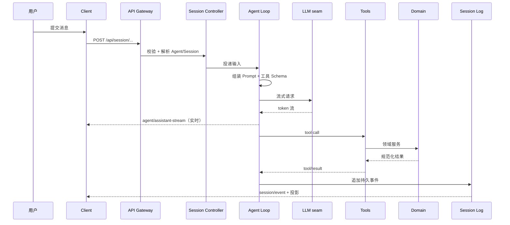

# Singularity Voyage 整体架构设计

> 状态：已按「个人 Agent（personal agent）」重定方向；M0 对话底座已落地  
> 编排内核：DeepSeek Harness `0.2.1-rc.2`（开发者预览，版本需精确锁定）  
> 关联文档：[README](../README.md)

---

## 0. 摘要与边界

### 0.1 目标

这是一个**个人 Agent**，不是团队协作平台。四条目标按优先级排列：

1. **记住一个人**：偏好、事实、人物、项目与历史决策可持续积累并主动召回；用户可查看、纠正、删除。
2. **主动但克制**：能按时提醒、汇总、巡检，而不是只能被动等输入；每类主动性都有频率上限与静默边界。
3. **四类场景共用一套记忆与工具**：个人助理（日程/待办/提醒）、第二大脑（知识/写作）、自动化管家（定时/监控）、长期陪伴；不是四个割裂的机器人。
4. **本地优先、隐私可控**：默认单机、单用户，数据留在本机；密钥与个人数据只在用户显式配置时才流向外部服务。

过程可回放（会话日志即事实）与供应商可替换（模型、检索、存储走 seam）继续作为工程约束，而不是产品卖点。

### 0.2 非目标

- 不重写 Agent Loop、模型协议、会话持久化、RPC 传输。
- 不做通用 BPM / 低代码工作流平台；自动化复用 `ctx.schedule`、`ctx.webhookRuntime`、`ctx.workflowEngine`。
- **不做团队/多租户形态**：不做组织权限、租户隔离、SaaS 计费、独立管理台。原 M4「团队化」从路线图移除，仅在单用户形态稳定后按需评估（见 8.8）。
- **暂不做 IM / 移动端入口**：先把 `/sv/` 做到自用顺手，触达形态确认后再扩展。
- 不维护 harness 私有 fork；确需改动时优先上游贡献，短期用 patch 隔离。

### 0.3 技术基线

| 项 | 选择 |
|---|---|
| 运行时 | Node.js `^22.19.0 || >=24.0.0` |
| 包管理 | pnpm `11.28.5` workspace |
| 语言 | TypeScript（Host 插件）+ 原生 JS（`/sv` 前端） |
| 编排 | DeepSeek Harness `0.2.1-rc.2` |
| 插件模型 | Cordis：服务、事件、可逆副作用 |
| 前端 | 自建 `/sv` 单页（原生 JS + CSS） |
| 默认模型 | DSH 默认路由，可由页面设置覆盖 |
| 本地存储 | Session JSONL + JSON/SQLite |
| 可选远程存储 | PostgreSQL + S3/MinIO（用户自建，非默认形态） |

### 0.4 Build / Buy / Don't build

| 类别 | 决策 |
|---|---|
| **直接使用** | Agent Loop、工具注册表与执行流水线、会话日志、System Prompt 组装、Skill 注册表、MCP 客户端、子 Agent、审批、沙箱、Web 传输、`ctx.schedule` / `ctx.webhookRuntime`、Typert API Gateway |
| **本项目构建** | 记忆服务、待办与提醒、个人知识、交付物、自动化编排、主动简报、领域工具、内置技能、`/sv` 页面、评测集 |
| **明确不自研** | 模型适配器、Agent Loop、RPC 框架、会话存储格式、调度器、浏览器壳层 |

---

## 1. 核心概念

| 概念 | 定义 | 与 DSH 的映射 |
|---|---|---|
| **Session** | 一次可持续的对话与执行上下文 | `ctx.sessions` + 仅追加 JSONL |
| **Turn / Step** | 一轮用户意图 / 一次模型请求加其工具调用 | `agent-loop` 的 turn/step 事件 |
| **Memory** | 跨会话保留的个人事实、偏好、人物、项目与决策，带来源与置信度 | 新增 `ctx.memory`（本项目） |
| **Task / Reminder** | 一条待办，或带触发时间的提醒 | `ctx.memory` 中的实体 + `ctx.schedule` |
| **Briefing** | 按计划生成并推送的个人简报（今日日程、待办、关注信息） | 定时任务 + 会话产物 + Web 收件箱 |
| **Artifact** | 可交付成果：报告、网页、表格、代码包 | 元数据在领域存储，字节在附件存储 |
| **Skill** | 按需加载的工作方法说明书 | `ctx.skills` + `skill` 工具 |
| **Tool** | 模型可调用的原子能力 | `ctx.tools` |
| **Connector** | 外部系统的连接：MCP 服务器或原生适配器 | `dsh-mcp-client` 配置行 + `ctx.connectors` 治理 |
| **Automation** | 定时或事件触发的 Agent 运行 | `ctx.schedule` / `ctx.webhookRuntime` + 产品编排 |
| **Knowledge Source** | 可检索的个人知识来源 | `ctx.knowledge` 领域服务 |
| **Mode** | 同一人格下的工作侧重，只收窄工具面，不改变记忆与事实源 | `ctx.agentPresets`（仅保留少量模式） |

> **命名约定**：npm 包 `@singularity-voyage/*`；Cordis 服务 `ctx.<domain>`；工具 `snake_case`，领域前缀；Skill `kebab-case`。

---

## 2. 运行时组合模型

### 2.1 Profile / Bundle / Patch

运行中的 `dsh` 是一棵按层叠加的 Cordis 插件树。`sv` profile 的叠加顺序：

```text
空条目列表
  ├─ @deepseek-ai/dsh-base          # 核心：模型、工具、会话、沙箱、审批、存储
  ├─ @deepseek-ai/dsh-web-app       # 浏览器应用、Connection、页面壳层
  ├─ @singularity-voyage/sv-app     # 本项目组合包：领域服务、工具、技能、客户端插件
  ├─ $DSH_HOME/profiles/sv/cordis.patch.yml   # 部署方覆盖
  └─ --patch <file>                 # 临时实验覆盖
```

规则：

- 每个组合包在 `package.json` 声明 `dsh.bundle.patch`，patch 文件按 `id` 定位条目。
- **patch 替换整段 `config`，不做深合并**；同一行以最后一层为准。
- 环境相关值用 `!!js` 表达式，避免把密钥写进 patch。
- 调试组合树：`dsh --profile sv --dump-config`。

### 2.2 本项目插件清单

| 包 | 类型 | ctx key | 职责 | 阶段 |
|---|---|---|---|---|
| `@singularity-voyage/sv-app` | bundle + 宿主插件 | — | 装配下列行；模型适配、搜索、聊天、会话投影、记忆、待办、提醒与 `/sv` 页面 | M0 ✅ |
| `dsh-computer-use` | 第三方 bundle + 宿主插件 | — | 桌面操作：`app_list` / `screen_observe` / `computer_*`，底层 cua-driver | M1 ✅（固定 `0.3.1`） |
| `@singularity-voyage/memory` | seam + 服务 | `ctx.memory` | 记忆的写入、去重、冲突、检索、纠正与删除 | M1 ✅（当前内置于 `sv-app/src/memory-store.ts`） |
| `@singularity-voyage/tasks` | 服务 | `ctx.tasks` | 待办与提醒实体、到期计算、完成与顺延 | M1 ✅（`sv-app/src/tasks-store.ts` + `reminders.ts`） |
| `@singularity-voyage/memory-local` | provider | — | 本地 JSON + 词面召回；SQLite 待规模需要 | M1 ✅（JSON） |
| `@singularity-voyage/knowledge` | seam + 服务 | `ctx.knowledge` | 个人知识导入、切块、检索、引用 | M2 |
| `@singularity-voyage/knowledge-local` | provider | — | 本地 SQLite FTS（向量按需） | M2 |
| `@singularity-voyage/artifacts` | 服务 | `ctx.artifacts` | 交付物元数据、版本、导出 | M2 |
| `@singularity-voyage/automations` | 服务 | `ctx.automations` | 定时/事件任务、简报、运行记录 | M3 |
| `@singularity-voyage/connectors` | 服务 | `ctx.connectors` | 个人 MCP 连接器目录与健康（按需） | M3 |
| `@singularity-voyage/tool-memory` | 工具 | — | `memory_search` / `memory_write` | M1 ✅（`sv-app/src/tools.ts`） |
| `@singularity-voyage/tool-task` | 工具 | — | `task_create` / `task_list` / `task_complete` | M1 ✅（`sv-app/src/tools.ts`） |
| `@singularity-voyage/tool-knowledge` | 工具 | — | `knowledge_search` / `knowledge_ingest` | M2 |
| `@singularity-voyage/tool-artifact` | 工具 | — | `artifact_create` / `artifact_export` | M2 |
| `@singularity-voyage/tool-automation` | 工具 | — | `automation_create` / `automation_list` | M3 |
| `@singularity-voyage/skills-builtin` | 技能包 | — | 内置技能：个人助理、写作、简报、周回顾 | M1–M3 |

> **先内置、后拆包**：M1 的记忆与待办先放在 `sv-app` 内（同一组合包、同一构建），等 M2 需要独立替换存储或单独评测时再拆成独立 workspace 包，避免过早引入跨包构建成本。
>
> 页面不单独成包：官方 `web-runtime` 已在 patch 中禁用，`/sv` 是 `sv-app` 自建的单页应用，新页面直接在 `packages/sv-app/web/` 内扩展。

### 2.3 人格与模式

个人 Agent 只有**一个人格**：`cordis.patch.yml` 的 `personaPrefix` 已注入，所有会话共用。不再按角色拆分 Preset —— 同一件事在不同「人格」下得出不同结论、写进不同记忆，是个人场景里最伤体验的失败模式。

`ctx.agentPresets` 只用于**模式（Mode）**：收窄工具面，不改变人格、不改变记忆与事实源。

| 模式 | 侧重 | 工具面 | 典型任务 |
|---|---|---|---|
| `assistant`（默认） | 日常对话、待办、提醒 | 只读工具 + `memory_*` / `task_*` | 「记一下」「提醒我」「今天有什么」 |
| `researcher` | 查资料、读网页 | Web、knowledge、memory | 调研、事实核对、资料综述 |
| `writer` | 写作与整理 | 文件、knowledge、artifact | 周报、文章、会议纪要 |
| `operator` | 自动化与监控 | automation、connector、受限 Shell | 定时简报、页面监控、巡检 |

约束：

- 每个模式可见工具 **≤ 12 个**，其余通过 Skill 指引或子 Agent 调用。
- `operator` 默认禁用危险 Shell；外部副作用一律 `ask`。
- 切换模式不复制会话、不清空上下文；记忆全局共享。
- 子 Agent 不继承全部工具；委派时显式收窄。

---

## 3. 请求与事件链路

### 3.1 一次对话



**记忆注入**：每轮组装 Prompt 前，`ctx.memory` 按当前输入与场景召回 Top-N 记忆和临期待办，作为独立段落附在 System Prompt 之后。召回命中的 `memoryId` 写入 step 事件，用于回放「它为什么记得这件事」。

### 3.2 工具执行流水线

```text
tools/pre-execute   allow | deny | cancel | ask
        ↓
ToolGuard           只可拒绝，不可放行
        ↓
tools/execute       超时、重试、指标包装
        ↓
execute()           工具本体，必须响应 exec.signal
        ↓
projectContent      安装执行期准备好的内容
        ↓
tools/post-execute  accept | replace | block
        ↓
finalizeContent     最后一次内容整形
        ↓
tools/result        冻结结果，供回放与持久化
```

设计含义：

- **策略与实现分离**：审批、脱敏、限流都在流水线监听器里做，工具本体保持简单。
- **参数不可改写**：历史、回放、UI、执行必须一致。
- **失败也是结果**：结构化错误进入会话日志，不终止整个轮次。
- **并行需显式声明**：只有 `isConcurrencySafe(args) === true` 才允许与兄弟调用并行。

### 3.3 实时与回放

| 用途 | 数据源 |
|---|---|
| 实时对话增量 | `agent/assistant-stream` |
| 实时提醒 | `ReminderService` 到期扫描 → `GET /sv/api/events`（SSE） |
| 持久事实 | `turn/*`、`step/*`、`message/*`、`tool/*` |
| 列表与会话摘要 | `ctx.sessionProjections` / `ctx.sessionQuery` |
| 回放与评测 | 会话日志导出 + 操作日志 |

原则：**客户端不把内存状态当事实**。所有可变视图都能从日志与投影重建。

提醒不写入会话日志：它属于待办领域事实（`notifiedAt` + `ReminderRun`），页面刷新后由 `/sv/api/tasks` 重建展示。

---

## 4. Skill 架构

### 4.1 来源与优先级

DSH 本地 Skill provider 的发现顺序（rank 越小越优先）：

| Rank | 来源 | 根目录 | 用途 |
|---|---|---|---|
| 100 | `project-dsh` | `<project>/.dsh/skills` | 项目私有、可提交 |
| 200 | `project-agents` | `<project>/.agents/skills` | **本项目主入口** |
| 300 | `custom` | 配置的 `customSkillDirs` | 自定义目录（同步盘、共享目录） |
| 400 | `user-dsh` | `$DSH_HOME/skills` | 个人技能 |
| 500 | `user-agents` | `$AGENTS_HOME/skills` | 个人跨项目技能 |
| 600 | `bundled` | 配置的 `bundledSkillDir` | 随发行版提供 |

规则：

- Skill 名 `kebab-case`，同名时最近作用域优先，同一层内按 rank、provider 顺序、本地顺序裁决。
- 目录包 `<name>/SKILL.md` 或平铺 `<name>.md`；不支持递归 `**/SKILL.md`。
- 正文按需加载，目录消息只含 `name` + `description`，避免上下文膨胀。
- `disable-model-invocation` / `user-invocable` 控制模型与用户调用面。

### 4.2 技能分层

| 层 | 示例 | 维护者 |
|---|---|---|
| 通用工作法 | `deep-research`、`structured-writing`、`meeting-notes` | 内置 |
| 个人助理 | `daily-briefing`、`weekly-review`、`inbox-triage` | 内置 |
| 写作与整理 | `long-form-writing`、`summarize-and-cite` | 内置 |
| 个人习惯 | 用户按自己的流程编写，放项目 `.agents/skills` | 个人 |

### 4.3 包格式与资源

```text
<skill-name>/
├── SKILL.md            # 必需：frontmatter + 指令正文
├── references/         # 可选：长文档、模板、检查清单
├── scripts/            # 可选：确定性脚本（优先于让模型手写）
├── assets/             # 可选：图片、样例数据
└── evals/              # 可选：回归用例
```

约束：

- Skill 是**指令**，不是工具；需要外部能力时引用已有工具。
- 脚本必须可重复执行、无隐式网络、无密钥硬编码。
- 资源通过相对路径引用，不枚举目录；大文件放知识库而非 Skill。
- Skill 正文建议 < 500 行；超出部分拆到 `references/`。

### 4.4 发布与治理

1. **作者**：在 `.agents/skills` 开发，热加载验证。
2. **评审**：检查触发描述、权限假设、失败路径、是否与已有 Skill 重叠。
3. **打包**：进入 `@singularity-voyage/skills-builtin`，随版本发布。
4. **启用**：按模式启用；保留上一版本。
5. **退役**：目录中移除，历史会话仍可回放。

治理指标：触发准确率、加载后任务成功率、平均加载次数、被误触发次数。

### 4.5 评测

- 每个核心 Skill 至少 5 条黄金任务：输入、期望产物结构、必须包含的事实。
- 确定性检查优先（文件存在、字段齐全、引用可解析），LLM Judge 只做兜底。
- 回归门禁：Skill 改动必须跑对应评测集，不允许只看单次演示。

### 4.6 反模式

- 把 API 文档整篇塞进 `SKILL.md`。
- 用 Skill 代替工具做确定性计算。
- 一个 Skill 覆盖多个不相关任务。
- 依赖“模型记得某条隐含规则”。

---

## 5. 工具层

### 5.1 已有 vs 新增

| 能力 | 来源 | 决策 |
|---|---|---|
| 文件读写、搜索、编辑 | `tool-fs` / `tool-fs-search` | 直接用 |
| Shell、后台任务、PTY | `tool-bash` / `tool-jobs` / `tool-terminal` | 直接用，按模式限制 |
| Web 搜索与抓取 | `tool-web` | 直接用，替换 provider |
| Skill 加载 | `tool-skill` | 直接用 |
| 子 Agent / 工作流 | `tool-subagent` / `tool-workflow` | 直接用 |
| 待办、目标、计划 | `tool-todo` / `tool-goal` / `plan-mode` | 直接用 |
| 桌面观察与操作 | 第三方 `dsh-computer-use`（cua-driver） | 直接用；固定版本，保留其安全护栏 |
| 知识检索 | 本项目 | 新增 |
| 记忆与待办提醒 | 本项目 | 新增 |
| 交付物 | 本项目 | 新增 |
| 自动化 | 本项目 | 新增 |
| 第三方系统 | MCP | 不新增原生工具，除非高频核心 |

### 5.2 工具设计规范

1. **单一职责**：一个工具只做一件事，名称即语义。
2. **声明式输出**：必须提供 `output.schema` 与纯函数 `render`；成功值是可校验 JSON。
3. **错误结构化**：区分参数错误、权限拒绝、外部失败、超时、取消。
4. **可取消**：异步工作必须观察或转发 `exec.signal`。
5. **超时**：声明 `timeoutMs` 的前提是能协作中止。
6. **并发**：只有无共享状态时才声明 `isConcurrencySafe`。
7. **展示**：提供 `presentCall` / `presentResult`，让 UI 渲染 diff、终端、搜索、读取等卡片。
8. **大结果**：超过阈值走 `ctx.spillStore`，返回定位信息而非整段文本。
9. **权限**：外部副作用默认 `ask`；只读工具可自动放行。
10. **可测试**：执行函数不依赖全局单例，领域服务可注入替身。

### 5.3 工具清单

| 工具 | 作用 | 后端 | 风险 | 默认策略 | 模式 | 状态 |
|---|---|---|---|---|---|---|
| `memory_search` | 检索个人记忆，返回带来源的条目 | `ctx.memory` | 低 | allow | 全部 | M1 ✅ |
| `memory_write` | 写入或更正一条记忆（必须带来源） | `ctx.memory` | 中 | ask | assistant、writer | M1 ✅ |
| `task_create` | 创建待办或提醒 | `ctx.tasks` | 中 | ask | assistant | M1 ✅ |
| `task_list` | 列出未完成待办与下次触发时间 | `ctx.tasks` | 低 | allow | 全部 | M1 ✅ |
| `task_complete` | 完成或顺延待办 | `ctx.tasks` | 低 | allow | assistant | M1 ✅ |
| `app_list` / `app_launch` / `screen_observe` / `screen_zoom` / `computer_*` | 观察并操作本机桌面应用 | 第三方 `dsh-computer-use` + cua-driver | 高 | 观察 allow；有副作用动作按护栏审批 | assistant、operator | M1 ✅ |
| `knowledge_search` | 混合检索，返回带引用片段 | `ctx.knowledge` | 低 | allow | 全部 | M2 |
| `knowledge_ingest` | 导入 URL/文件到个人知识库 | `ctx.knowledge` | 中 | ask | researcher、writer | M2 |
| `artifact_create` | 创建交付物草稿 | `ctx.artifacts` | 低 | allow | writer | M2 |
| `artifact_export` | 导出 Markdown/HTML | `ctx.artifacts` | 低 | allow | writer | M2 |
| `automation_create` | 创建定时/事件任务 | `ctx.automations` | 高 | ask | operator | M3 |
| `automation_list` | 列出任务与状态 | `ctx.automations` | 低 | allow | operator | M3 |
| `automation_pause` | 暂停任务 | `ctx.automations` | 中 | ask | operator | M3 |
| `connector_list` | 列出可用连接器与健康 | `ctx.connectors` | 低 | allow | 全部 | M3 |

> **自动记忆抽取不走工具**：turn 结束后由后台任务从本轮对话中抽取候选记忆，去重后入库。模型只在需要显式纠正或新增时调用 `memory_write`，避免每轮都产生写入噪音。
>
> **`task_complete` 之外没有 `task_snooze`**：顺延走 `/sv/api/tasks/:id` 的 `snoozeMinutes`，只在页面上使用；模型侧保持工具面最小（5 个）。

工具命名使用 `snake_case`，领域前缀避免与 MCP 工具冲突。MCP 工具固定为 `mcp__<server>__<tool>`。

### 5.4 工具预算与上下文

- 每个模式可见工具 ≤ 12；全局注册可以更多，但通过 `ctx.tools.restrict` 收窄。
- 工具描述控制在 1–2 句；复杂用法写进 Skill，不写进 schema。
- 高频组合用 Skill 固化流程，减少模型探索成本。
- 大量并行子任务交给子 Agent，避免主会话上下文被工具结果淹没。
- 大结果依赖上游 `tool-result-pruner` 与 `spill-policy`，领域工具不要重复实现截断。

### 5.5 展示与交互

工具通过中性的 `ToolCallView` / `ToolResultView` 描述展示意图：

- `generic`：默认卡片。
- `terminal`：命令与退出状态。
- `diff`：文件创建/修改。
- `search`：grep/glob 结果。
- `read`：带行号的文件读取。
- `web`：搜索来源与抓取状态。

领域工具优先复用这些卡片；确实需要专用视图时，在 `/sv` 前端注册 keyed renderer，不在 Host 引入前端框架。

---

## 6. MCP 架构

### 6.1 连接模型

- 每个 MCP 服务器一条 `@deepseek-ai/dsh-mcp-client` 配置行。
- 传输：本地 `stdio`；远端 `streamable-http`。
- 工具自动注册进 `ctx.tools`，继承取消、权限检查、结果记录、图片附件。
- 连接生命周期：启动探测 → 发现工具 → 原子换代 → 断线重连 → 失败保留上一代。

### 6.2 命名与作用域

- 模型可见名称：`mcp__<serverName>__<rawName>`。
- `serverName` 满足 `[A-Za-z0-9_-]{1,32}`，在同一注册作用域内唯一。
- 不同 Agent 作用域可以复用同名服务器，连接与工具彼此隔离。
- 权限规则与会话历史依赖稳定名称，因此**不随远程 `serverInfo.name` 变化**。

### 6.3 配置与密钥

```yaml
- insert:
    - id: mcp-notion
      name: '@deepseek-ai/dsh-mcp-client'
      config:
        serverName: notion
        transport: streamable-http
        url: https://mcp.notion.example/v1
        headers:
          Authorization: !!js '`Bearer ${process.env.NOTION_TOKEN}`'
        toolCallTimeoutMs: 60000
        failOnStartupError: false
        reconnect:
          enabled: true
          maxAttempts: 10
```

密钥原则：

- 不把明文写入 `cordis.patch.yml` 或仓库。
- 优先从进程环境或 DSH 凭据存储注入；MCP 客户端支持的是 `env` / `headers`，因此由部署层负责解析。
- stdio 子进程环境会清洗 `*KEY*`、`*TOKEN*`、`*SECRET*` 与 `DSH_*`，再合并显式配置。
- 日志与操作记录中不记录完整 header。

### 6.4 治理

| 风险 | 控制 |
|---|---|
| 恶意/被投毒服务器 | 白名单、固定版本、来源 review |
| 供应链执行 | stdio 服务器运行在容器/受限用户，不挂载宿主目录 |
| 数据外泄 | 出网策略、按服务器限制可访问资源 |
| 工具爆炸 | 按模式只启用必要服务器；`ctx.tools.restrict` 收窄 |
| 启动拖慢 | `failOnStartupError: false` + 超时 + 健康检查 |
| 重连风暴 | 指数退避 + 最大尝试次数 + 熔断 |

> 注意：DSH 的文件/命令沙箱**不自动覆盖 MCP stdio 子进程**。把 MCP 服务器视为独立的不受信任服务，用容器或独立用户隔离。

### 6.5 与原生工具的取舍

| 场景 | 选择 |
|---|---|
| 第三方 SaaS、长尾系统 | MCP |
| 高频核心能力、需要精细展示/审批 | 原生工具 |
| 需要严格输出 schema 与领域事务 | 原生工具 + 领域服务 |
| 只是把外部 API 包一层 | MCP，不新增原生工具 |
| 需要统一审批与用量统计 | 原生连接器服务 + 内部 provider |

### 6.6 失败与可观测

- 记录：服务器名、传输、发现耗时、工具数量、最近错误码、重连次数。
- 指标：连接可用率、工具调用 P95、错误率、超时率。
- 告警：连续重连失败、工具代际回滚、指令超限。
- 操作日志：服务器配置变更、启用/禁用、凭据轮换。

---

## 7. 前端架构

### 7.1 形态

- **唯一主形态**：`sv-app` 自建的 `/sv` 单页。官方 Web UI（`web-runtime`）已在 patch 中禁用，页面通过 `/sv/api/*` 桥接 harness，不引入第二套 RPC 契约。
- **对话是主场**：记忆、待办、知识、任务都作为同一应用内的页签或侧栏，而不是另一套后台系统。
- **可选**：Headless / CLI 调用同一 Host，用于批处理、自测与后续 IM 接入。
- **暂不做**：桌面壳、独立管理台、移动端原生应用（见 0.2 非目标）。

### 7.2 页面信息架构

| 页面 | 核心内容 | 主要数据 | 状态 |
|---|---|---|---|
| **对话（Workbench）** | 对话、工具卡片、Trace、附件、当前待办 | Session 事件流、transcript 投影 | M0 ✅ |
| **记忆（Memory）** | 记忆条目、来源、置信度、编辑/删除 | `ctx.memory` | M1 ✅ |
| **待办（Tasks）** | 待办、提醒、下次触发时间、完成/顺延 | `ctx.tasks` + 提醒 SSE | M1 ✅ |
| **知识（Knowledge）** | 个人知识源、同步状态、检索调试、引用预览 | `ctx.knowledge` | M2 |
| **产出（Artifacts）** | 草稿、版本、导出记录 | `ctx.artifacts` | M2 |
| **洞察（Insights）** | Token/成本、工具失败、提醒触达与忽略率 | `ctx.sessionQuery` + OTel | M4 |
| **设置（Settings）** | 模型、搜索、连接器、隐私（导出/清空）、遥测 | 配置存储 + `ctx.connectors` | M0 部分 ✅ |

> 三块入口在 `/sv` 侧栏：对话 / 待办 / 记忆。窄屏（≤720px）侧栏转为抽屉 + 遮罩，避免遮挡主区。其余页面按里程碑逐步加入，不预先搭空壳。

### 7.3 数据流

```text
用户操作
  ├─ 命令类：POST /sv/api/config、/memories、/tasks、/stop   // 一元请求
  ├─ 实时类：POST /sv/api/chat（SSE 对话流）、GET /sv/api/events（SSE 提醒流）
  └─ 列表类：GET /sv/api/sessions、/memories、/tasks          // 投影
```

已实现的 `/sv/api` 契约（M0 + M1）：

| 方法 | 路径 | 说明 |
|---|---|---|
| GET | `/sv/api/state` | 脱敏配置 + 模型目录 |
| POST | `/sv/api/config` | 保存模型/搜索配置（密钥不回传） |
| POST | `/sv/api/chat` | SSE 对话流（`session` / `text-delta` / `tool` / `done`） |
| POST | `/sv/api/stop` | 中止当前轮次 |
| POST | `/sv/api/test` | 模型或搜索连通性测试 |
| GET | `/sv/api/sessions` | 会话索引 |
| GET | `/sv/api/sessions/:id/messages` | transcript 投影 |
| PATCH / DELETE | `/sv/api/sessions/:id` | 重命名 / 删除投影 |
| GET / POST | `/sv/api/memories` | 记忆列表（`?q=` 召回）/ 手动新增 |
| PATCH / DELETE | `/sv/api/memories/:id` | 编辑 / 删除记忆 |
| GET / POST | `/sv/api/tasks` | 任务列表（`?done=1`）/ 创建 |
| PATCH / DELETE | `/sv/api/tasks/:id` | 修改（含 `snoozeMinutes`）/ 删除 |
| GET | `/sv/api/events` | SSE 提醒流（`{type:"reminder",task}`） |

规则：

- 客户端不直接拼装模型历史，不复制会话日志作为事实源。
- 命令成功与否以 Host 事件为准；乐观更新只用于纯本地交互。
- 所有流支持取消；切换会话时中止旧流。
- 二进制内容（图片、附件、交付物）走后端授权读取，不在客户端持久化密钥。
- 接口变更必须同步更新 `web/` 调用方与 `test/` 用例；`/sv/api` 是与前端唯一约定。

### 7.4 组件与交互规范

- **工具卡片**：复用现有 Trace 分类与折叠逻辑；新工具优先复用通用卡片。
- **流式**：token 流与工具调用分离渲染；工具结果落定后再显示最终卡片。
- **记忆可见**：回答中引用了记忆时，可展开查看条目、来源与时间，并提供「记错了 / 忘记它」入口。
- **长任务**：显示阶段、当前工具、已耗时、取消入口；后台任务转「待办」页。
- **引用**：知识回答必须可点击到来源与片段；无法定位时明确标注。
- **错误**：区分“模型说错”“工具失败”“权限拒绝”“网络失败”，给不同恢复动作。
- **国际化**：中英双语，文案与代码分离。
- **可访问性**：键盘导航、焦点管理、对比度、屏幕阅读器标签。

### 7.5 权限与安全

- UI 只做能力提示，**不是安全边界**；Host 端审批、沙箱与 `remoteAccess` 才是。
- 凭据只显示掩码与状态，永不回传明文。
- 连接器配置页展示权限范围与最近调用，不展示 token。
- 破坏性操作（删除记忆/知识源、暂停自动化、清空数据）二次确认，并写入本地操作日志。
- 页面默认只监听 `127.0.0.1`；远程访问必须置于带鉴权的反向代理之后。

### 7.6 技术选型

- **前端**：无框架原生 JS + CSS 单页，由 `sv-app` 直接托管；页面复杂到需要组件化时再评估 React，不在 M1 前引入构建链。
- **状态**：服务端事实来自 `/sv/api` 与会话事件流；本地只缓存 UI 状态（当前会话、折叠态）。
- **样式**：沿用 `web/app.css` 现有变量与密度，不引入 UI 组件库。
- **测试**：`node:test` 覆盖纯逻辑（如 Trace 分类、事件关联、渲染分支）；关键路径以手工冒烟为主，页面复杂后补 E2E。

---

## 8. 数据服务架构

### 8.1 事实源与派生层

```text
事实源
  ├─ Session JSONL（仅追加、版本化、可压缩）
  │     ├─ 投影：turn boundary、todo、goal、title、artifact 引用
  │     ├─ 索引：会话全文、时间线、成本
  │     └─ 回放：工具、审批、外部副作用
  └─ Memory Store（可编辑，带来源，与日志通过 sessionId / toolCallId 关联）

领域事实
  ├─ 待办 / 提醒 / 触发记录
  ├─ 知识源 / 文档 / 切块 / 索引
  ├─ 交付物 / 版本 / 导出记录
  ├─ 连接器 / 配置版本 / 健康
  └─ 自动化 / 运行记录

二进制
  └─ 附件 / 对象存储（内容寻址）
```

原则：

- 先写日志，再更新派生层；派生层可重建。
- 投影单元幂等；重建命令必须存在。
- **记忆不是日志的只读投影**：日志保留原文与来源，记忆保留「当前有效的结论」，允许用户纠正或删除；两者靠 `source` 关联而不是互相覆盖。
- 领域写入使用领域服务，不直接改存储键。
- 所有索引带 schema 版本，升级可迁移。

### 8.2 存储分层

| 层 | 本地（默认） | 可选远程 | 说明 |
|---|---|---|---|
| 会话日志 | `$DSH_HOME/sessions` JSONL | 对象存储 + Postgres 元数据 | 事实源，不可变 |
| 投影缓存 | JSON / SQLite | Postgres | 可重建 |
| 记忆 | `$DSH_HOME/sv/memory.json` 或 SQLite | Postgres | 可编辑、可删除、可导出 |
| 待办与提醒 | `$DSH_HOME/sv/tasks.json` | Postgres | 与记忆分开存，避免抽取误伤日程 |
| 会话检索 | SQLite FTS | Postgres FTS | 按需开启 |
| 知识检索 | SQLite FTS（向量按需） | pgvector | 个人规模下 FTS 通常够用 |
| 领域数据 | JSON + 本地目录 | Postgres | 交付物、自动化、连接器 |
| 二进制 | 本地附件目录 | S3/MinIO | 内容寻址、授权读取 |
| 大工具结果 | `spill-local` | 对象存储 | 超阈值溢出 |

> 个人 Agent 默认只跑本地一列；「可选远程」仅在用户自己配置 Postgres/S3 时启用，不作为产品形态。

### 8.3 领域数据模型

| 实体 | 关键字段 | 所有者 | 说明 |
|---|---|---|---|
| `Session` | `sessionId`、`workspaceId`、`mode`、`createdAt` | 上游 | 日志为事实 |
| `SessionProjection` | `sessionId`、`state`、`version` | 上游 | 列表/标题/待办 |
| `Workspace` | `workspaceId`、`root`、`name` | 上游 | 工作目录注册 |
| `Memory` | `memoryId`、`kind`（fact/preference/person/project/decision）、`text`、`source`、`confidence`、`tags`、`updatedAt` | 本项目 | 可编辑、可删除；冲突保留来源 |
| `Task` | `taskId`、`title`、`dueAt`、`status`、`recurrence`、`sourceMemoryId` | 本项目 | 待办与提醒共用 |
| `ReminderRun` | `runId`、`taskId`、`firedAt`、`outcome` | 本项目 | 触达、忽略、顺延 |
| `KnowledgeSource` | `sourceId`、`type`、`uri`、`status` | 本项目 | URL、文件、目录 |
| `Document` | `documentId`、`sourceId`、`hash`、`mime`、`version` | 本项目 | 原始文档元数据 |
| `Chunk` | `chunkId`、`documentId`、`ordinal`、`text`、`tokens` | 本项目 | 检索单元 |
| `Artifact` | `artifactId`、`taskId`、`kind`、`title`、`currentVersion` | 本项目 | 交付物 |
| `ArtifactVersion` | `versionId`、`artifactId`、`blobRef`、`hash`、`createdAt` | 本项目 | 不可变版本 |
| `Connector` | `connectorId`、`kind`、`serverName`、`configRef`、`status` | 本项目 | 不存明文密钥 |
| `Automation` | `automationId`、`trigger`、`mode`、`prompt`、`enabled` | 本项目 | 定时/事件，含简报 |
| `AutomationRun` | `runId`、`automationId`、`sessionId`、`status` | 本项目 | 可追溯到会话 |
| `OperationLog` | `eventId`、`actor`（user/agent）、`action`、`target`、`decision`、`at` | 本项目 | 仅追加 |
| `EvalCase` / `EvalRun` | `caseId`、`suite`、`input`、`checks`、`score` | 本项目 | 评测 |

### 8.4 记忆与待办管线

M1 已落地（`packages/sv-app/src/memory-store.ts`、`memory-extractor.ts`、`tasks-store.ts`、`reminders.ts`）。存储为本地 JSON（0600），与会话日志分离。

```text
对话轮次
  ├─ 结束前：召回（当前用户输入 → memory.recall）→ 注入 System Prompt 段 sv:memory-recall
  └─ 结束后：异步抽取（低温度单次调用）→ 候选解析 → 去重合并 → memory.json

待办
  ├─ 工具创建（task_create）/ 页面创建
  ├─ 30s 扫描到期（dueAt <= now 且未提醒）→ 写 notifiedAt → 广播 reminder 事件 → /sv/api/events
  └─ 重复任务滚动：daily +24h / weekly +7d，直到严格晚于当前时刻
```

关键决策：

- **记忆不是日志投影**：日志保留原文，记忆保留可编辑的当前结论；两者靠 `sessionId` 关联。
- **抽取与写入解耦**：抽取失败、超时（25s）、JSON 不可解析都返回空数组，不影响对话。
- **召回是可解释的**：词重叠（英文词 + 中文二元组 + 单字子串）+ 标签 + 置信度 + 30 天时效；无命中就不注入。
- **去重不看标点**：同 `kind` 且归一化文本相同视为同一条，置信度取高、标签取并集。
- **记忆与待办分开存**：抽取可能出错，不能让它改写日程（决策 D9）。
- **提醒走进程内扫描，不用 `ctx.schedule`**：M1 只需页面内触达；把消息投回会话触发模型留给 M3 简报。
- **通知只推送一次**：一次性任务记 `notifiedAt` 后不再提醒，直到用户主动顺延。

### 8.5 知识库管线

```text
导入 → 解析 → 规范化 → 切块 → 嵌入 → 索引 → 检索 → 重排 → 引用
```

关键决策：

- **切块**：标题感知、400–800 tokens、10–15% 重叠；保留页码/段落定位。
- **检索**：先 FTS/BM25；召回不足时再引入向量与 RRF 融合，避免为个人规模过度设计。
- **引用**：每个片段带 `documentId`、`sourceId`、位置、原文哈希；回答必须能回溯。
- **增量**：内容哈希去重；删除用墓碑；同步失败不破坏旧索引。
- **隐私**：个人知识默认仅本机可读，不做跨来源 ACL；导入外部内容时标记来源与时间。
- **多模态**：先做文本；图片/表格按需引入 OCR/表格解析。
- **评测**：recall@k、引用准确率、答案有据率、拒答率。

本地实现：SQLite FTS5 起步，向量索引作为可选增强。云端不是产品形态，不维护第二套实现。

### 8.6 交付物

- **元数据**在领域存储；**字节**在本地附件目录，内容寻址。
- 版本不可变；编辑产生新版本，可回滚。
- 导出先做 Markdown / HTML；PDF、DOCX、PPTX 在确有需要时再接入。
- 交付物与 Session/Task 关联，支持“这次回答产出了什么”的追溯。
- 预览在 `/sv` 右侧面板；大文件不在消息里内联。

### 8.7 一致性、重建与保留

- **写入顺序**：Session 事件 → 投影 → 领域索引。任一步失败可重放。
- **幂等**：投影器与索引器以事件 id 去重。
- **重建**：提供 `memory reindex`、`knowledge reindex`、`projection rebuild`、`session export` 命令。
- **迁移**：领域 schema 版本化；破坏性变更需要双写/回填。
- **保留**：会话日志默认永久保留，可配置 TTL；记忆与待办支持单条删除和全量清空；操作日志不可由页面删除。
- **备份**：本地数据目录（JSON/SQLite/附件）整体可备份；配置 Postgres 时另做逻辑备份。

### 8.8 单用户边界与多用户（延后）

当前设计是**单用户、单实例**：

- 所有存储无 `tenant_id`、无 RLS、无组织权限；数据目录即个人边界。
- 身份只有「本机使用者」，不引入 OIDC 与租户上下文。
- 远程访问通过反向代理 + 简单鉴权解决，不进入产品模型。

原 M4「团队化」已从路线图移除。若未来确有需求，必须作为独立项目重做身份、存储分区、全量 ACL 与审计，而不是在当前模型上加一个开关。

---

## 9. 安全、权限与操作日志

### 9.1 威胁模型

| 威胁 | 入口 | 控制 |
|---|---|---|
| 提示词注入 | 网页、知识文档、MCP 返回 | 内容标记为数据、工具白名单、外部副作用审批 |
| 恶意 MCP 服务器 | stdio / HTTP | 来源审核、固定版本、容器隔离、最小环境 |
| 密钥外泄 | 工具输出、日志、前端 | 凭据 seam、输出脱敏、前端只读掩码 |
| 越权操作 | 工具调用、`/sv/api` | 沙箱、审批、模式工具限制、仅本机监听 |
| 个人数据外泄 | 数据目录、导出、备份、远程访问 | 目录 0700、密钥 0600、导出需确认、默认不暴露公网 |
| 记忆污染 | 自动抽取、外部内容 | 来源标注、置信度、注入前过滤、可编辑可删除 |
| 供应链 | npm 依赖、MCP 包 | 锁文件、版本固定、许可证检查 |

### 9.2 权限矩阵

| 操作 | 默认 | 说明 |
|---|---|---|
| 读取工作区文件 | allow | 沙箱内 |
| 写入工作区文件 | allow（workspace-write） | 越界需审批 |
| 执行 Shell | ask | 按模式可放宽只读命令 |
| 访问网络 | allow（抓取公开地址） | 内网/私有地址拒绝 |
| 调用 MCP 只读工具 | allow | 服务器需在白名单 |
| 调用 MCP 写工具 | ask | 按服务器配置 |
| 修改/删除记忆 | allow | 本人操作，留操作日志 |
| 读取/创建/完成待办 | allow | 只影响本机日程；`memory_write` 与 `task_create` 在模型侧仍按模式放宽 |
| 操作桌面应用界面（点击 / 输入） | ask（危险词审批，密码框拒绝） | 第三方 `dsh-computer-use` 护栏；无新鲜快照直接拒绝 |
| 创建/暂停自动化 | ask | 写操作日志 |
| 修改凭据 | ask + 二次确认 | 仅本机使用者 |
| 导出/清空数据 | ask + 二次确认 | 破坏性操作 |

### 9.3 操作日志

操作日志用于回答「它为什么这么干」，不是合规审计：

```json
{
  "eventId": "...",
  "actor": { "type": "user" },
  "sessionId": "...",
  "action": "tool.call",
  "target": { "tool": "knowledge_ingest", "source": "..." },
  "decision": "allowed",
  "policy": "workspace-write",
  "at": "2026-10-21T00:00:00Z"
}
```

操作日志与会话日志分离：会话日志面向回放，操作日志面向追溯；两者通过 `sessionId` / `toolCallId` 关联。

---

## 10. 可观测性与评测

### 10.1 指标

| 类别 | 指标 |
|---|---|
| 体验 | 首 token 延迟、轮次 P50/P95、取消率 |
| 工具 | 调用量、错误率、超时率、审批等待时长 |
| 模型 | Token 用量、缓存命中、成本/会话 |
| 记忆 | 召回命中率、注入后被纠正率、误记率 |
| 主动性 | 提醒准时率、忽略率、静默时段触发次数 |
| 检索 | recall@k、引用准确率、空结果率 |
| 连接器 | 可用率、重连次数 |
| 自动化 | 成功率、平均时长、人工接管率 |

### 10.2 追踪

- 使用 DSH 的 OTel 通道，统一 trace：`turn` → `llm.request` → `tool.call` → `retrieval` / `mcp.call`。
- 日志结构化，禁止记录密钥与完整外部响应。
- 产品埋点与操作日志分开；遥测默认最小化并尊重关闭开关。

sv-app 的日志格式（`packages/sv-app/src/log.ts`）：

```text
[sv-app][<module>] <event> key=value ... err=<message>
```

| 约定 | 规则 |
|---|---|
| module | `index` / `chat` / `http` / `reminders` / `memory` / `tasks` |
| event | 小写 snake_case，动作在前：`*_failed` / `*_ready` / `*_extracted` |
| 字段 | 数字与布尔裸写；含空格加引号；`undefined`/`null` 省略；`err` 永远行尾 |
| 级别 | `info` 状态变化与成功写入；`warn` 可降级失败；`error` 请求/数据无法处理；`debug` 堆栈 |
| 脱敏 | 不记录密钥、完整 header、记忆正文与任务备注（只记 id 与数量） |

dsh 内核默认不输出 logger 到控制台，因此 `sv-app` 自带一个只输出自身消息的 exporter：`error`/`info`/`warn` 走 stdout 并按本地日期追加到 `logs/sv-YYYY-MM-DD.log`，`debug` 留在 buffer。这样终端、日志文件与页面的「运行日志」都能用 `grep '\[sv-app\]'` 精确筛出本项目日志。

### 10.3 评测体系

| 层 | 内容 |
|---|---|
| 单元 | 工具 schema、记忆抽取与去重、待办到期计算、领域服务 |
| 契约 | `/sv/api` 接口、会话事件、投影 |
| 端到端 | Mock LLM 跑固定任务，校验工具序列与产物 |
| 评测集 | 记忆召回、提醒准时、简报有用性、写作引用四类个人任务 |
| 回归门禁 | 核心 Skill/工具/记忆策略改动必须跑对应评测集 |

M1 已落地的自动化覆盖（`pnpm test`，58 条用例）：

| 测试文件 | 覆盖 |
|---|---|
| `memory-store.test.ts` | 去重合并、kind 隔离、召回排序、删除后不再注入、持久化回环、坏文件容错、分词 |
| `tasks-store.test.ts` | 到期判断、一次性不重复提醒、每日滚动、完成/顺延、排序、promptBlock、持久化回环 |
| `memory-extractor.test.ts` | 裸 JSON / 围栏 / 对象包裹解析、非法项跳过、条数截断、提醒广播 |

---

## 11. 部署拓扑

### 11.1 本地开发

```text
pnpm dev（dsh --profile sv --no-open），DSH_HOME 默认 <repo>/.dsh
  ├─ Host：单进程 Cordis 树
  ├─ 存储：<repo>/.dsh
  │     ├─ sessions/            会话 JSONL（dsh）
  │     ├─ logs/                启动诊断（dsh）
  │     └─ sv/
  │           ├─ config.json    模型/搜索配置与密钥（0600）
  │           ├─ sessions.json  会话索引 + transcripts/
  │           ├─ memory.json    长期记忆
  │           └─ tasks.json     待办与提醒
  └─ 浏览器：127.0.0.1:7000/sv/
```

> dsh 默认使用 `~/.dsh`；本项目的 `pnpm dev`、`scripts/start.sh`、`scripts/setup-profile.mjs` 都把 `DSH_HOME` 默认指向仓库内 `.dsh/`，实现与机器上其它 dsh 实例隔离且可整体迁移。`.dsh/` 已被 gitignore，其中 `sv/config.json` 含密钥。

### 11.2 远程访问（可选）

```text
Browser
  → 反向代理（TLS + 鉴权）
  → dsh Host（单实例，仅监听 127.0.0.1）
      └─ $DSH_HOME（会话、记忆、待办、附件）
```

要点：

- `/sv` 与 SSE 长连接依赖流式转发，代理需关闭响应缓冲并给足空闲超时。
- 鉴权在代理层做；应用本身不内置账号体系。
- 暴露前先做备份，并确认没有把 `$DSH_HOME` 映射到公共目录。

### 11.3 多设备与迁移（可选）

- 不提供云端托管形态；单机是默认且唯一的产品形态。
- 多设备只在用户自行配置 Postgres 时共享会话、记忆与待办；否则以导出/备份迁移为主。
- 迁移单位是数据目录：会话 JSONL + 记忆/待办 JSON + 附件目录，导入后重建索引。

---

## 12. 里程碑

> 原则：每个里程碑以「能在真实自用中每天用一次」为标准，不以功能数量为标准。顺序对应四条场景：助理 → 知识 → 自动化 → 一体化。

### M0 对话底座（已完成）

交付：

- pnpm workspace、TypeScript 基线、类型检查与测试。
- `sv-app` 组合包、`sv` profile、`cordis.patch.yml` 叠层。
- 自定义 OpenAI 兼容模型路由、Tavily/博查搜索。
- `/sv` 对话页、SSE 流式、Trace 面板、会话投影与跨进程恢复。
- 配置持久化与供应商预设。

完成标准（已达成）：`pnpm dev` 启动；`/sv/` 可对话；token 与搜索 API 可在页面配置并热生效；重启后会话仍在。

### M1 个人助理：记忆 + 待办/提醒（已完成）

交付（均已实现）：

- `ctx.memory` 最小实现：turn 结束后异步抽取候选、去重与冲突合并、Top-N 召回注入、来源与置信度。
- `ctx.tasks`：待办与提醒实体、到期计算、完成/顺延、Web 内提醒。
- `/sv` 增加「记忆」「待办」两块：查看、纠正、删除、忽略。
- 工具：`memory_search`、`memory_write`、`task_create`、`task_list`、`task_complete`。
- 存储：`$DSH_HOME/sv/memory.json`、`tasks.json`（0600，原子替换写入）。
- 测试：`memory-store.test.ts`、`tasks-store.test.ts`、`memory-extractor.test.ts`。

与计划的偏差：

- 记忆与待办先内置于 `sv-app`，未拆成独立 workspace 包（见 2.2「先内置、后拆包」）。
- 提醒用进程内 30s 扫描 + 页面 SSE，未接 `ctx.schedule`；后者留给 M3 会话级简报。
- `daily-briefing` 技能尚未编写，随 M3 简报一起落地。

完成标准（已验证）：

- 跨会话记得上次说过的偏好与进行中的事，注入段落可追溯到记忆条目。
- 「提醒我明天 10 点交材料」→ 到点在页面上出现，可完成或顺延。
- 纠正或删除一条记忆后，下一次回答立即不再使用它。

### M2 第二大脑：个人知识 + 写作

交付：

- `ctx.knowledge` 本地实现：Markdown/文本/网页导入、切块、SQLite FTS 检索、引用定位。
- `knowledge_search` / `knowledge_ingest` 工具；回答中的引用可点击回原文。
- 写作链路：读取记忆 + 知识 → 生成草稿 → 保存为工作区文件并登记为产出。
- `/sv` 增加「知识」页；产出在对话侧栏预览。

完成标准：

- 导入一批个人笔记后，提问能给出可点击来源，而不是泛泛而谈。
- 能基于多份笔记合成一篇草稿，落到工作区可继续编辑。

### M3 自动化管家：主动简报与监控

交付：

- `ctx.automations`：定时（每日/每周）与事件触发（网页变化、关键词命中）。
- 简报统一进入 `/sv` 收件箱；支持静默时段、频率上限、一键暂停。
- 工具：`automation_create` / `automation_list` / `automation_pause`；启用 `operator` 模式。
- 运行记录、失败重试与下次触发时间可见。

完成标准：

- 每日早间简报自动生成，包含今日待办与关注变化。
- 一个网页监控任务能发现变化、触达用户并留下运行记录。
- 任何主动消息都能追溯到触发规则与被使用的数据。

### M4 一体化与长期自用

交付：

- 四个场景共用同一记忆与任务模型；冲突消解、优先级与「最近使用」排序。
- 隐私闭环：按来源导出/删除、全量清空、备份与恢复。
- 评测：记忆召回、提醒准时率、简报有用性（人工打分）、写作引用准确率。
- 成本与失败面板；长会话压缩与记忆衰减策略。

完成标准：

- 连续一周真实自用：记忆没有明显误记，提醒没有漏报或骚扰。
- 数据可导出、可清空；换机器能完整迁移。

---

## 13. 关键决策与风险

### 13.1 架构决策

| ID | 决策 | 理由 |
|---|---|---|
| D1 | 基于 DSH，不 fork | 复用成熟 Loop、工具流水线、会话与权限；降低长期维护成本 |
| D2 | 会话日志是对话事实源，记忆是用户可改的当前结论 | 可回放，同时允许用户纠正而不与日志冲突 |
| D3 | 领域服务做成 seam，本地优先 | 本地 JSON/SQLite 起步；远程存储仅作为可选能力，不维护第二套形态 |
| D4 | 第三方系统优先 MCP | 接入快、命名稳定、生态复用 |
| D5 | 核心高频能力做原生工具 | 需要精细 schema、展示、审批与事务 |
| D6 | 前端自建 `/sv` 单页 | 官方 Web UI 已禁用；单一前端避免双契约 |
| D7 | 精确锁定 dsh 版本 | 开发者预览期存在破坏性变更 |
| D8 | 单用户、单实例 | 个人 Agent 的边界就是数据目录；多租户是另一个产品 |
| D9 | 记忆与待办分开存储 | 自动抽取可能出错，不能让它直接改写日程 |
| D10 | 主动性克制 | 默认只读巡检；每类提醒有频率上限与静默时段 |
| D11 | Web-first 触达 | 先把 `/sv` 做顺手；IM/移动端在触达需求明确后再评估 |

### 13.2 风险

| 风险 | 影响 | 缓解 |
|---|---|---|
| DSH 破坏性变更 | 构建/运行中断 | 精确锁版本；契约测试；薄适配层；上游贡献 |
| 前端与 Host 契约漂移 | 页面返工 | 只用 `/sv/api`；接口变更同步测试与调用方 |
| 工具/上下文膨胀 | 成本上升、选择困难 | 模式限制、Skill、子 Agent、compaction |
| 误记与记忆污染 | 用户信任下降 | 来源标注、置信度、可编辑删除、注入前过滤 |
| 主动打扰 | 用户关闭通知 | 静默时段、频率上限、一键暂停、可追溯触发规则 |
| MCP 供应链 | 安全事件 | 白名单、固定版本、容器隔离、最小权限 |
| 检索质量不稳定 | 回答不可信 | 先 FTS + 引用可点击；召回不足再加向量与重排 |
| 成本失控 | 长期使用不可持续 | 模型路由、缓存、压缩、用量面板与告警 |

---

## 14. 首批落地清单（M1 纵向切片，已完成）

按“能被自己每天用一次”的最小闭环推进，不先铺基础设施。实际落地与差异：

| # | 计划 | 落地情况 |
|---|---|---|
| 1 | `Memory` 数据结构：`kind` / `source` / `confidence` / 生命周期 | ✅ `memory-store.ts` 的 `MemoryEntry`，新增 `tags` |
| 2 | 本地 memory store（JSON 起步），关键词/标签检索 | ✅ `memory.json` + 词面打分（二元组 + 单字 + 标签 + 时效） |
| 3 | turn 结束异步抽取、去重合并、Top-N 注入 | ✅ `memory-extractor.ts` + `systemPrompt.section('sv:memory-recall')` |
| 4 | `/sv` 记忆页：列表、来源、编辑、删除 | ✅（「忽略」未做，删除已覆盖该语义） |
| 5 | `ctx.tasks` 与到期提醒 | ✅ 用进程内扫描替代 `ctx.schedule`，页面 SSE 触达 |
| 6 | 五个工具注册并接入 Trace | ✅ `tools.ts`，Trace 复用通用卡片 |
| 7 | 测试：去重、召回、到期、删除后不再注入 | ✅ 三个测试文件，22 条用例 |
| 8 | 以该切片为模板复制到 knowledge / automation | 待 M2 / M3 |

验收（已达成）：跨会话记得偏好；提醒准时出现在页面；删掉的记忆下一次回答不再使用。

遗留项（进入 M2/M3 前需要处理）：

- 注入段目前不回写 `memoryId` 到 step 事件——想要“它为什么记得”的完整回放，需要在组装时记录命中 id。
- 记忆与待办未提供整体导出/清空入口（M4 隐私闭环的一部分）。
- 窄屏抽屉是本轮顺带修复的旧问题，未加键盘焦点管理（可访问性遗留）。
